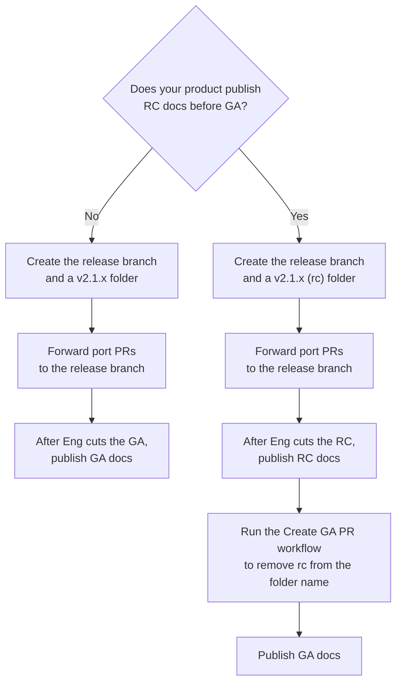

# Web Unified Docs content-related processes

> [!NOTE]
> Click the GitHub UI's **Outline** button, which is next to the **Edit this file** button,
> to toggle this page's outline.

## Repo workflows

- PR labeler  
  - [Code](https://github.com/hashicorp/web-unified-docs/blob/main/.github/workflows/label-content-prs.yml) by Sarah Chavis  
  - Automatic labeling when PR created  
- Issue form and labeler  
  - [Code](https://github.com/hashicorp/web-unified-docs/blob/main/.github/workflows/label-issues.yml) by Aimee Ukasick. Lengthy explanation in the [merged PR description](https://github.com/hashicorp/web-unified-docs/pull/1028).
- Create release PR  
  - [Code](https://github.com/hashicorp/web-unified-docs/blob/main/.github/workflows/create-release-pr.yml) by Sarah Chavis  
  - From Sarah: The action creates a PR to merge the release branch into main, but having a robot create the PR means you can (hopefully) create and approve the publication PR on your own the same way we used to approve backports in the product repos. It's a strictly manual workflow, so you need to open it on the actions page to run it.
- Preview to GA toggle (folder rename) action by Sarah Chavis
  - [Code](https://github.com/hashicorp/web-unified-docs/actions/workflows/create-ga-pr.yml)
- Forward port workflow
  - [Workflow file](https://github.com/hashicorp/web-unified-docs/blob/main/.github/workflows/forward-port-pr.yml)
  - Replaces the old Sync GA to RC branch script. When a merged PR carries a
    `forward-port:<slug>` label, the workflow automatically opens a PR that
    copies the changed files from the source version folder into a target
    version folder, such as an upcoming RC or beta release folder. You can also
    manually trigger the forward port workflow from the GitHub Actions UI.
  - Forward port only works within one repository. A label on a PR in
    `web-unified-docs` can't open a PR against a release branch in
    `web-unified-docs-internal`. The README describes a manual workaround that
    forward ports the Repo sync PR instead.
  - Full setup and usage instructions are in the [forward-port-README](https://github.com/hashicorp/web-unified-docs/blob/main/scripts/forward-port/forward-port-README.md)
- Broken link monitoring system  
  - [BROKEN_LINK_MONITORING.md](./BROKEN_LINK_MONITORING.md)  
- How to use redirects  
  - [redirects.md](./content-guide/redirects.md)  
- PR templates  
  - Jonathan Frappier created the PR template links.  
  - You may create product-based PR templates. Refer to the [PULL_REQUEST_TEMPLATE folder](https://github.com/hashicorp/web-unified-docs/tree/main/.github/PULL_REQUEST_TEMPLATE) for examples.

## Repo structure

- Publish branch is `main`.  
- Each documentation project has its own directory.  
  - For products other than HCP, published versions are in directories, not
    branches. Published version folder name has a specific format.  
    - GA: `<version>`  such as v1.10.x, v1.11.x, v2.1.x  
    - alpha: `<version>` (alpha) such as v2.1.x (alpha)  
    - beta: `<version>` (beta) such as v2.1.x (beta)  
    - RC: `<version>` (rc) such as v2.1.x (rc)  
    - The release stage tag must be lowercase. The build only accepts
      `alpha`, `beta`, and `rc`, and fails on any other tag, including `(RC)`.  
  - Folders whose names contain no number are not published, such as Vault’s global/partials folder.  
  - To stop publishing an older version, delete its folder. Git history keeps
    the content. Don't rename the folder with a suffix such as `-archive`. The
    build treats any folder name that contains a number as a version, so
    `v1.0.x-archive` still publishes. Do not delete a prior version folder
    without checking IBM docs content retention policies.
- Branch naming conventions  
  - Release branch names start with `<product>/`.  
  - Upcoming major release  
    - `<product>/<exact-release-number>`
    - for example: `nomad/2.0.0`  
  - Upcoming minor release  
    - This varies by product but must start with `<product>/`.  
    - Vault creates minor release branches by YYYYMM. For example: `vault/202509`  
    - Nomad creates minor release branches using the release number. For example: `nomad/1.11.1`  

## Workflows

These are generic workflows for major and minor releases, and for a new
product's beta docs.

### Upcoming major release

The workflow depends on whether your product publishes an RC docs set before
GA. Not all products do.

The following sections describe each step. Both paths share the first two
steps. For publishing, follow [Publish GA-only docs](#publish-ga-only-docs) or
[Publish RC and then GA docs](#publish-rc-and-then-ga-docs).

#### Create the release branch and folder

Create the branch and folder as close as possible to when content work
starts.

1. Create the upcoming major release branch. Use the
   `<product_name>/<release_number_exact>` naming convention, such as
   `nomad/2.1.0`.
1. Immediately after you create the branch, create a release folder in that
   branch. The folder name depends on whether you publish RC docs.

   - GA-only docs: Use `v<release_number>.x`, such as `v2.1.x`.
   - RC docs: Use `v<release_number>.x (rc)`, such as `v2.1.x (rc)`.

   The tag must be lowercase. Web unified docs publishes this folder as a new
   version after you merge your release branch to `main`.

#### Forward port PRs to the release branch

Follow the forward port process for open PRs in the current version that
meet both of these conditions.

- The PR will merge to `main`.
- The PR content should be copied from the current version folder to the
  upcoming major release branch's next version folder. For example, from the
  `nomad/v2.0.x` folder on `main` to the `nomad/v2.1.x` folder on the
  `nomad/2.1.0` branch.

Refer to the
[forward-port-README](../scripts/forward-port/forward-port-README.md) for
setup and usage.

#### Publish GA-only docs

1. A day before or the same day that Eng cuts the GA, merge from `main` to
   ensure the release branch is current.
1. Compare the current version folder and the release folder. Copy new and
   updated files to the release folder.
1. Create a PR to merge the release branch to `main`. Use one of these
   methods.

   - Manual: Open a PR with the release branch as the head and `main` as the
     base.
   - Automatic: Run the **Create publication PR** workflow,
     [`create-release-pr.yml`](../.github/workflows/create-release-pr.yml),
     from the GitHub Actions UI. Enter the release branch name and keep
     `main` as the merge target. The workflow opens a PR titled
     `[PUBLISH] <release-branch>`.

   Approve the PR, but don't merge it yet.
1. After Eng cuts the GA, merge the release branch PR into `main`. This
   publishes the GA docs and deletes the release branch.

#### Publish RC and then GA docs

1. A day before or the same day that Eng cuts the RC, merge from `main` to
   ensure the release branch is current.
1. Compare the current version folder and the RC release folder. Copy new and
   updated files to the RC release folder.
1. Create a PR to merge the release branch to `main`. Use one of these
   methods.

   - Manual: Open a PR with the release branch as the head and `main` as the
     base.
   - Automatic: Run the **Create publication PR** workflow,
     [`create-release-pr.yml`](../.github/workflows/create-release-pr.yml),
     from the GitHub Actions UI. Enter the release branch name and keep
     `main` as the merge target. The workflow opens a PR titled
     `[PUBLISH] <release-branch>`.

   Approve the PR, but don't merge it yet.
1. After Eng cuts the RC, merge the release branch PR into `main`. This
   publishes the RC docs and deletes the release branch.
1. Open any docs updates between RC and GA as PRs to `main`.
1. When Eng cuts the GA, run the **Create GA PR** workflow,
   [`create-ga-pr.yml`](../.github/workflows/create-ga-pr.yml), from the
   GitHub Actions UI. Enter the version without the `v` prefix, such as
   `2.1.x`, the tag, such as `rc`, and the product slug. The workflow opens a
   PR against `main` that renames `v2.1.x (rc)` to `v2.1.x`.

   The workflow adds a `v` prefix to the folder name, so it doesn't work for
   folders without one, such as TFE's `2.1.x`. Rename those folders in a PR
   by hand.
1. Merge the Create GA PR workflow's PR into `main`. This publishes the GA
   docs.

### Upcoming minor release

Follow these steps to document an upcoming minor release.

#### Create the minor release branch

Create the minor release branch as close as possible to when content work
starts. Branch names vary by product. For example, Nomad uses `nomad/1.11.1`
and Vault uses `vault/202512`.

#### Forward port PRs to an active major release branch

If there is an active upcoming major release branch, follow the process in
[Forward port PRs to the release branch](#forward-port-prs-to-the-release-branch).

#### Before Eng cuts the minor release

Complete these steps a day before or the same day that Eng cuts the minor
release.

1. Merge from `main` to ensure the release branch is current.
1. Create a PR to merge the release branch to `main`. Use one of these
   methods.

   - Manual: Open a PR with the release branch as the head and `main` as the
     base.
   - Automatic: Run the **Create publication PR** workflow,
     [`create-release-pr.yml`](../.github/workflows/create-release-pr.yml),
     from the GitHub Actions UI. Enter the release branch name and keep
     `main` as the merge target. The workflow opens a PR titled
     `[PUBLISH] <release-branch>`.

   Approve the PR, but don't merge it yet.

#### After Eng cuts the minor release

Merge the release branch PR into `main`. This publishes the content and
deletes the minor release branch.

### Publish a beta docs set for a new product

To publish a new product's first docs as a beta, follow
[Add a versioned docs set to developer.hashicorp.com](./workflows/add-versioned-docs.md).
That guide covers the branch, folder naming, PRs, publishing, and moving the
beta to GA.
